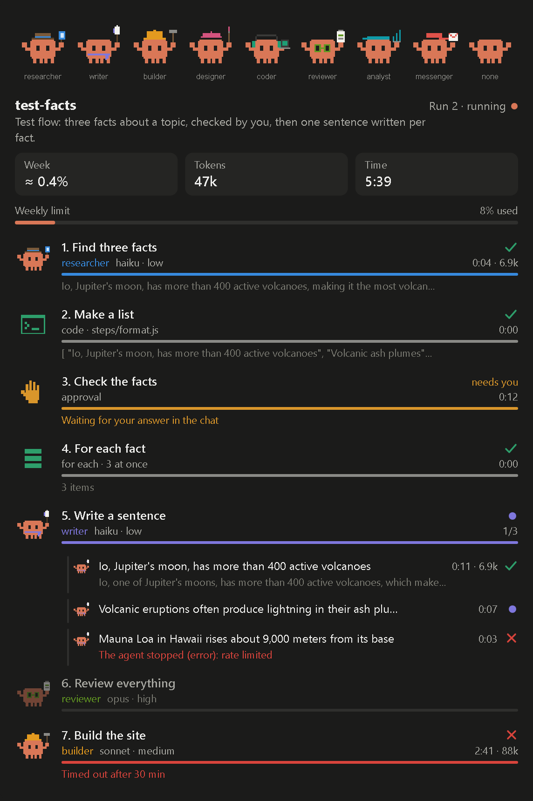
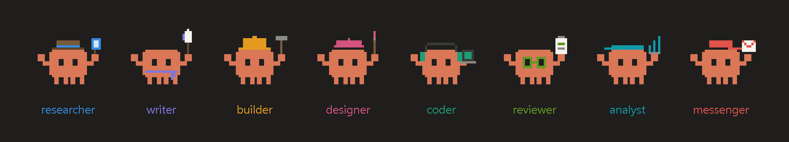

<div align="center">

# Flows

**Saved, repeatable AI automations for Claude Code: describe one in the chat, run it with one command, watch it step by step in a pane.**

A flow is a short list of steps (AI agents, Node scripts, approvals and a for-each) where each step hands its result to the next. Claude writes it with you once; from then on it runs the same way every time.

[](.claude-plugin/plugin.json)
[](https://docs.claude.com/en/docs/claude-code)
[](LICENSE)
[](#requirements)



</div>

## Why

Asking Claude for the same multi-step job twice gives two different jobs: other steps, other models, other prompts, and no record of what each part did. A flow fixes the steps once. Each agent has its own model, effort, instruction and time limit; the parts that need no judgement are plain scripts that run **in code, with no model**; and nothing goes past an approval without your answer.

## How it works

Ask in your own words, in any language: "open the flows", "write a flow that finds the best pages about a topic and summarises each one", "run page-summary on volcanoes", "try it without spending tokens", "stop it", "take it up again", "only redo the second one", "copy it to page-summary-2". The commands below do the same, for those who prefer them.

A flow is written once and kept for every session, in `~/.claude/flows`. Each run's files go to the folder of the session that runs it, and its agents work there.

### Write it once

```
/flows new page-summary find the best pages about a topic and summarise each one into a file
```

Claude interviews you in rounds of numbered questions, each with the answer it recommends, until it is sure of what you want. Then it proposes the flow: the steps appear in the pane as a draft, and the chat shows what was assumed, what was left out, and the code of every script. **Nothing is saved until you say so.**

### Run it

```
/flows run page-summary volcanoes
```

The plugin decides each step and runs the scripts itself; the session's Claude only starts the agents the plugin names and puts the approvals to you. What one step hands the next travels through files, not through the chat.

- **Every step sees the whole run**: its own input, the run's input, the flow's inputs, the result of every step before it, and the flow's memory.
- **Results are checked.** A step with a `schema` gets its result checked against it; one of the wrong shape goes back to its agent with what is wrong, twice by default, before the step fails.
- **Each item goes its own way.** After a for-each, every item runs the steps after it on its own, and its approval comes as soon as it gets there.
- **Approvals** are asked in the chat, shown the way the flow says (`show`), with where the files are and which item it is ("1 of 3"): approve, approve with your changes, approve every item waiting at once, reject, or send back to the agent with a note.
- **A failed step** stops its item. Claude says what failed and proposes one fix; with your yes, it makes the fix and takes the run up again at that step, every failed item or only one.
- **Stopping the chat stops the flow**, and so does asking Claude to stop it. Asking to take it up again (or `/flows retry`) goes on where it stopped; asking for a new run while one is going stops the old one first, once you say so.
- **Test runs** (`/flows run <name> --test`, or "try it") start no agent: each agent step hands on a made-up result of its shape, the approvals pass by themselves, and the scripts run with `dry: true`. They cost no tokens.
- **Ceilings and estimates**: `maxTokens` on a step fails it past that many tokens, on the flow stops the run; starting a run says what its last finished run took.
- **It works in Auto mode**, with no permission prompts along the way.

### The steps

| Step | What it does |
| --- | --- |
| `agent` | An AI worker with its own model, effort, instruction, time limit and role; optionally a `schema` for its result, `retries`, `maxTokens`. |
| `code` | A Node.js script, for work that needs no judgement. It reads `{ input, runInput, vars, outputs, memory, item, flow, run, track, runDir, cwd, dry }` as JSON on stdin; what it prints is handed on. Exit code 3 ends the flow there. |
| `approval` | Stops until you answer in the chat; `show` says what you read, with `{{field}}` from the JSON it receives. |
| `each` | Splits a list (JSON, or one item per line) and runs every step after it once per item, three at a time by default (`parallel`), at most `max` items. One per flow. |

Any agent or code step can be marked `remember`: its result is added to the flow's memory, `memory.md` beside its `flow.json`, which every later run reads (the leads already found, say). A flow can list `inputs` (`{ id, description, type, required, default }`, typed `string`, `number`, `boolean` or `list`): its run's input is then those values, and Claude asks for the ones that are needed.

### The cast

Every agent step is a pixel crab in the costume of its role, and it moves while it works.

<div align="center">

</div>

## Commands

Everything here can also be asked for in plain words; Claude does it with the plugin's `manage` tool.

| Command | What it does |
| --- | --- |
| `/flows` | Opens or closes the pane. The **Flows** button above the prompt does the same. |
| `/flows list` | Lists the project's flows: what each does and how its last run went. |
| `/flows <name>` | Shows that flow in the pane. Add a number to see an earlier run: `/flows <name> 2`. |
| `/flows new <name> <what it should do>` | Writes a new flow with you, in the chat. |
| `/flows edit <name> <what to change>` | Changes a flow. |
| `/flows run <name> [input]` | Runs a flow. The input is what its first step receives, or `key=value` pairs for a flow with inputs. `--test` makes a test run, `--new` stops the run still going and starts anew. |
| `/flows retry <name> [item]` | Takes up a run that failed or was stopped, at the step where it stopped; with a number, only that item. |
| `/flows delete <name>` | Deletes a flow, its scripts and its runs. It says what goes first, and deletes when you repeat it with `yes`. |

A name takes lower-case letters, digits and hyphens. Copying, renaming, bringing a flow over from a folder, starting at a step and changing only some steps are asked for in plain words.

## The pane

At the top, the flow shown as a card (how its last run went, and when); click it, or press Enter, and the other flows open under it, the ones running or waiting on you first. Picking one shows it. Everything else (running, stopping, writing, approving) is asked in the chat. Then: the flow and its run, three tiles (what the run took of your weekly limit, its tokens, its time), what you should know about the run (a test run, more items than the flow takes, a ceiling reached) and where its files are, and one row per step with its state, its time and tokens, and the first line of its result. The items of a for-each sit under their step. In a terminal the pane is text.

## Where flows live

A flow is kept once, for every session, in `~/.claude/flows/<name>/`: its `flow.json`, the scripts of its code steps and its memory. Its runs go to the folder of the session that runs it, `Flows/<name>/runs/<n>/`, so each project keeps its own:

```
~/.claude/flows/
  page-summary/
    flow.json
    steps/2-unique.js
    memory.md      what its "remember" steps handed on, run after run

<the session's folder>/Flows/
  page-summary/
    runs/3/        one folder per run; the last ten are kept
```

Flows from before 0.9, kept in a project's `Flows` folder, are listed as not brought over yet; ask Claude to import them. Add `Flows/*/runs/` to a project's `.gitignore` to keep its runs out of git.

<details>
<summary>A small <code>flow.json</code></summary>

```json
{
  "description": "Summarises a web page in three points and saves them to a file.",
  "steps": [
    {
      "id": "summarise",
      "type": "agent",
      "name": "Summarise the page",
      "description": "Reads the page and writes its title and three points.",
      "role": "researcher",
      "model": "sonnet",
      "effort": "low",
      "instruction": "The input is the address of a web page. Read it and answer with one JSON object: {\"title\": \"...\", \"points\": [\"...\", \"...\", \"...\"]}."
    },
    {
      "id": "save",
      "type": "code",
      "name": "Save the file",
      "description": "Writes the summary as a Markdown file.",
      "file": "steps/2-save.js"
    }
  ]
}
```

</details>

## Install

In Claude Code:

```bash
/plugin marketplace add yirasso/flows-mod
/plugin install flows@flows-mod
```

Then start a new session (or run `/reload-plugins`) and type `/flows`.

## Requirements

| Needed for | Tool |
| --- | --- |
| Everything | [Claude Code](https://docs.claude.com/en/docs/claude-code), in the desktop app's Code tab or the terminal |
| Code steps | [Node.js](https://nodejs.org) |

Flows is tested most on **Windows** in Claude Desktop; macOS and Linux are supported but less exercised.

## Models and privacy

Flows calls a model only through Claude Code itself, on your own account:

| When | Model |
| --- | --- |
| Writing or changing a flow, and carrying a run from step to step | Your session's model |
| Each agent step | The model and effort that step names |
| Code steps, approvals, the for-each, the pane | None |

Nothing is sent anywhere else. Two things to know before you run a flow someone else wrote:

- **An agent** may read files anywhere, search the web, and write inside the project. Any other tool has to be listed in its step.
- **A code step** is an ordinary Node.js script: it runs with your rights, with no sandbox. Read it first, the same as any script.

## Limits

- **A flow runs inside a session.** The chat is busy while it runs, and closing the session stops it; `/flows retry` takes it up again. The session's Claude starts each agent the plugin names (a plugin cannot start agents itself in Auto mode), so every step's start passes through the chat, though not its result.
- **A ceiling is checked when a step ends**, not while its agent works.
- **No schedules yet.** A flow starts by hand.
- **The week figure is approximate.** It is the weekly limit's percent used after the run minus before it, so other work in the same minutes counts too.
- **The plugin API is early access.** Function hooks may change between Claude Code releases.

## Develop

```bash
git clone https://github.com/yirasso/flows-mod.git
cd flows-mod
claude plugin validate .
claude plugin test .
```

Load your working copy with `claude --plugin-dir <path to the clone>`.

| Path | What it is |
| --- | --- |
| `hooks/register.tsx` | The hooks, the two tools Claude calls, the command and the pane |
| `hooks/flow.ts` | The rules of a flow and of a run |
| `hooks/author.ts` | What Claude is told when writing a flow, and the check of what it proposes |
| `hooks/draw.ts` | The pane's drawings |
| `hooks/picker.tsx` | The pane's flow picker, drawn on the surface itself |
| `types/index.d.ts` | The plugin's state contract |
| `tests/` | Tests for the rules, a whole run, and writing a flow |

[SPEC.md](SPEC.md) records what was decided and why, including the two designs that were tried and dropped. Issues and pull requests are welcome.

## Thanks

The way the characters are drawn (pixels on a grid, moved by CSS inside an SVG) follows the [savvy-progress](https://github.com/JohnnyVizz/claude-kit/tree/main/plugins/savvy-progress) mod by JohnnyVizz. The crab and its costumes were drawn from scratch for Flows.

## License

[MIT](LICENSE) © Tomas Girao
